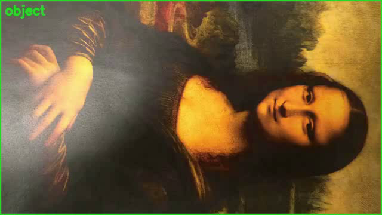
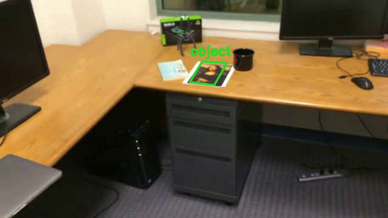
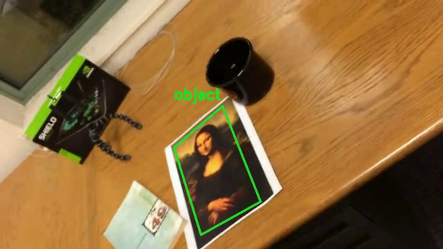

# Лабораторная работа 2. Трекинг по ключевым точкам

Программа следит за плоским объектом на видео. Первый кадр — крупное изображение этого объекта. Дальше на кадрах, где объект узнаётся, рисуется рамка по его углам и подпись.

Ролики преподавателя лежат в папке test-videos рядом с lab2. Без аргументов программа читает оттуда все avi и mp4.

Зависимости: numpy 1.26.4, opencv-python-headless 4.10.0.84.

Запуск из папки lab2:

- .venv/bin/python main.py
- .venv/bin/python main.py --input mona-lisa.avi --label object

Свой ролик, если первый кадр — сам объект:

- .venv/bin/python main.py --input my_test.mp4 --output results/my_test.mp4 --label object

## 1. Теоретическая база

Объект на первом кадре плоский. Его изображение на следующих кадрах — тот же четырёхугольник после сдвига, поворота и масштаба. Такое преобразование задаётся матрицей гомографии.

- SIFT находит точки на кадре и строит дескриптор, устойчивый к масштабу.
- Дескрипторы первого кадра сравниваются с дескрипторами текущего.
- Для каждой точки шаблона берутся два ближайших совпадения. Пара остаётся, если лучшее заметно ближе второго. Порог — 0.75.
- По хорошим парам RANSAC оценивает гомографию и отбрасывает случайные совпадения. Пар должно быть хотя бы 10, и столько же точек должны лечь в найденную матрицу.
- Четыре угла первого кадра переводятся гомографией в текущий кадр. Это и есть рамка.
- Когда открытка далеко, своих точек на ней меньше десяти: сильные точки кадра оказываются на мониторах и столе. Тогда рамку на один кадр переносят углы вокруг прошлого положения. Их сдвиг считается оптическим потоком Лукаса–Канаде, и по нему снова строится гомография.
- Рамка отбрасывается, если угол вышел за кадр или две соседние вершины слиплись.

## 2. Описание разработанной системы

Файлы:

- tracker.py — поиск объекта и рисование рамки;
- main.py — чтение видео, запись результата и трёх кадров-превью.

Как устроен трекер:

- первый кадр переводится в серый, SIFT оставляет до 500 точек;
- на каждом кадре точки ищутся так же и сравниваются через BFMatcher.knnMatch;
- cv2.findHomography с методом RANSAC строит матрицу, cv2.perspectiveTransform переносит углы;
- если совпадения не сошлись, cv2.goodFeaturesToTrack берёт углы вокруг прошлой рамки, cv2.calcOpticalFlowPyrLK переносит их на текущий кадр, и рамка сдвигается вместе с ними;
- рамка рисуется четырёхугольником, над верхним краем пишется подпись.

## 3. Результаты работы и тестирования системы

Ролик mona-lisa.avi, 558 кадров. Рамка есть на 536 кадрах.

Первый кадр — сама картина, рамка по краю:

Средний кадр, открытка далеко. Своих точек уже мало, рамку держит сдвиг точек вокруг неё, и она остаётся на картине:

Последний кадр, открытка снова ближе, рамка на картине:

На mona-lisa-blur.avi рамка на 517 кадрах из 558, на дальнем кадре тоже на открытке. На самом смазанном ролике, mona-lisa-blur-extra-credit.avi, на 510 из 558, дальний кадр тоже с рамкой на картине.

На simple_track.avi рамка на 511 кадрах из 557. В середине она на открытке. На последнем кадре четырёхугольник ломается: одна сторона уезжает по нижнему краю.

Свой ролик my_test.mp4, 339 кадров, рамка есть на 308. Объект — почти белый лист. В задании для ключевых точек нужен предмет с текстурой, у листа её нет. Рамка на кадрах есть, но с краями листа не совпадает: её тащат точки обивки вокруг.

Что из этого следует:

- на ролике с открыткой рамка уменьшается вместе с ней и остаётся на картине, когда камера отъезжает;
- сильный смаз и ролик с подписью поверх кадра дают кадры без рамки или со сломанным четырёхугольником;
- белый лист без рисунка этим алгоритмом не обводится.

## 4. Выводы по работе

- Ключевые точки и гомография дают рамку плоского объекта: она поворачивается и уменьшается вместе с ним.
- Одного SIFT на весь кадр мало. На дальнем плане детектор оставляет точки стола и мониторов, поэтому положение дотягивается по потоку вокруг прошлой рамки.
- Если угол вышел за кадр или стороны слиплись, такой четырёхугольник не рисуется.
- Для своего ролика нужен предмет с рисунком. Пустой лист точек не даёт, и рамка с краями не совпадает.

## 5. Использованные источники

- OpenCV 4.10.0: SIFT_create, BFMatcher.knnMatch, findHomography с RANSAC, perspectiveTransform, goodFeaturesToTrack, calcOpticalFlowPyrLK. Разбор по установленному пакету opencv-python-headless.
- Lowe D. G. Distinctive Image Features from Scale-Invariant Keypoints. International Journal of Computer Vision, 2004. Дескриптор SIFT и отбор совпадений по отношению расстояний до ближайшего и второго соседа.
- Lucas B. D., Kanade T. An Iterative Image Registration Technique with an Application to Stereo Vision. Proceedings of the International Joint Conference on Artificial Intelligence, 1981. Оптический поток, которым рамка переносится, когда своих точек уже мало.
